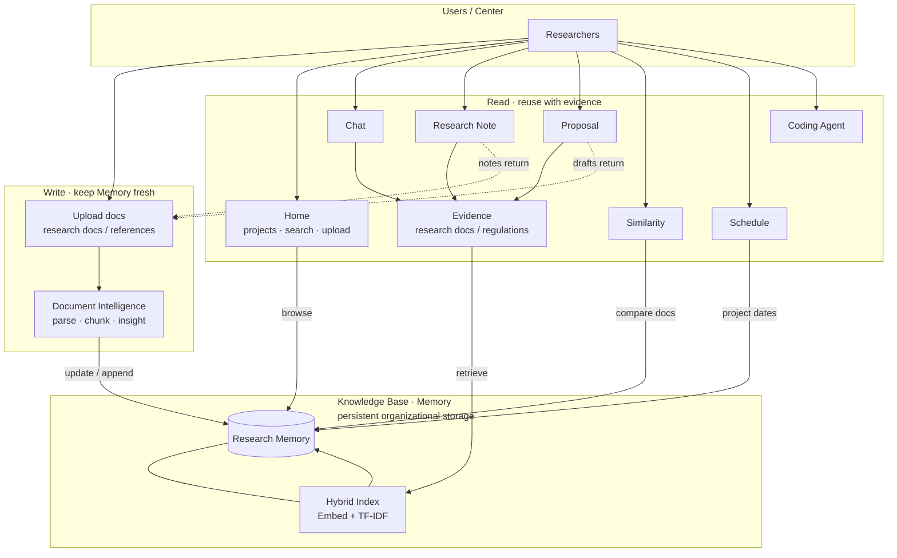

[한국어](README.md) | **English**

# Research Memory Platform

**An Organizational Research Intelligence Platform**

A knowledge base system built on past research assets — enabling AI to store, understand, and reuse institutional knowledge.

### Goals

1. Enable evidence-based reuse of organizational research assets
2. Preserve and operationalize institutional research knowledge

---

## How it works



Supported formats (documents): PDF, DOCX, TXT/MD, CSV, XLSX, HWP/HWPX  
Meeting recordings: MP3, WAV, M4A, WEBM, OGG, FLAC (Research Notes · meeting mode, optional STT)

Search: Ollama embeddings (`nomic-embed-text`) + TF-IDF combined via **hybrid (RRF)** fusion.
Falls back to TF-IDF only when embeddings are unavailable.

---

## UI tabs

| Tab | Description |
| --- | --- |
| **Home** | Research Memory dashboard: projects, search, upload, recent documents, document detail/roles (research doc / reference), and Document Insight. |
| **Schedule** | Monthly calendar for project meetings, submissions, tasks, and milestones. Click an empty day cell to add, click a chip to edit. (Notifications and external calendar sync are referenced from [myown](https://github.com/sumin-ma-1/myown).) |
| **Chat** | Ask questions against Memory. Each answer cites its source (file, location) tagged as `[research doc]` or `[regulation]`. Refuses to answer without evidence. |
| **Research Notes** | Draft research notes or meeting minutes. References Memory + uploads (meeting mode: recording/transcript). Table preview, DOCX/HWPX download, save to Memory. |
| **Proposal** | Upload an RFP and generate a center-part draft with compliance points, grounded in **research docs + regulations**. This is not a full proposal auto-generator. |
| **Similarity** | Compare a new document against Memory (or two documents against each other) at the sentence, page, and image level. Uses MiniLM + pHash for duplicate and reuse detection. |
| **Coding Agent** | Local Ollama + deepagents-code coding workbench: chat, file explorer, editor, terminal, threads, and Excel/CSV inspect/analyze/transform. Workspace stored under `data/coding_agent/`. |

---

## Run

### Web (Research Platform)

On the team server (Docker), just open the browser:

- URL: [http://bigsoft.iptime.org:51100/](http://bigsoft.iptime.org:51100/)
- Enter the web password (`RM_APP_PASSWORD`) on the first screen

Local run:

```bash
cd /mnt/data/eunbi/research-memory
./run_app.sh
# Browser: http://127.0.0.1:8505
```

(First time only: Python 3.12+ venv + `pip install -r requirements.txt`, set `RM_APP_PASSWORD` in root `.env`)

### Telegram Bot

Separate process from the web app — the bot must be running to answer DMs.  
Only registered Telegram User IDs may query Memory via **private DM** (`/today`, `/week`, natural language). No replies in groups.

**1) Start the bot in a terminal**

```bash
cd /mnt/data/eunbi/research-memory
./run_telegram.sh
```

(First time: `pip install -r telegram_memory/requirements.txt`, set `TELEGRAM_BOT_TOKEN` in `telegram_memory/.env`.  
Optional second bot: `TELEGRAM_BOT_TOKEN_SECONDARY` — same Memory/allowlist; one `./run_telegram.sh` polls both.)

**2) Register users in the web UI**

1. Open [http://bigsoft.iptime.org:51100/](http://bigsoft.iptime.org:51100/) and log in with the web password  
2. Sidebar **Advanced → Telegram user admin**  
3. Enter the admin password (`RM_TELEGRAM_ADMIN_PASSWORD`, different from the web password)  
4. Add **Telegram User ID** + display name

**How to find a User ID**

1. In Telegram, search `@userinfobot` → **Start**  
2. Copy the numeric ID (~10 digits)  
3. Paste it into the admin page and save  

Registered users can then DM the Research Bot directly.

### Data storage

| Path | Contents |
| --- | --- |
| `data/raw/` | Uploaded original files |
| `data/kb/memory.sqlite3` | All metadata — documents, projects, schedule items, indexes |
| `data/kb/*.pkl` | Search indexes (TF-IDF, vector) |
| `data/coding_agent/` | Coding agent threads, checkpoints, and workspace |
| `telegram_memory/data/chat.sqlite3` | Telegram Q&A log + allowed User IDs (bot-local; not the Memory KB) |

---

## Project layout

```
app.py                 UI (Streamlit)
research_memory/
  pipeline/            Document parsing · metadata/fact extraction · ingest
  kb/                  Knowledge Base (SQLite + hybrid index)
  engine/              Chat · Similarity · Proposal · Schedule · Research Note
                 docsim/  (similarity: MiniLM · parsers · pHash)
coding_agent/          Coding agent workbench (deepagents-code · Ollama · Excel)
telegram_memory/       Research Memory Bot (Telegram, read-only)
```

---

## Credits

Calendar UI and notification/external calendar integration referenced from [myown](https://github.com/sumin-ma-1/myown).
